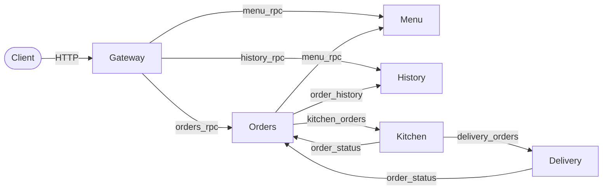

# Pizza Delivery Microservices

A small event-driven pizza delivery system built with six Python services that
communicate through RabbitMQ (AMQP). Each business service owns its own domain
logic and its own SQLite database.

The client talks to the **Gateway** over HTTP. The Gateway is an API layer that
calls backend services over RabbitMQ using synchronous RPC (request/reply with a
correlation id). Orders, Kitchen and Delivery exchange messages asynchronously.

## Architecture



Nodes are services, and every edge label is a RabbitMQ queue name. Labels ending
in `_rpc` (`menu_rpc`, `orders_rpc`, `history_rpc`) are synchronous RPC calls;
all other arrows are asynchronous messages.

Service responsibilities:

| Service    | Role                                            | Storage                              |
|------------|-------------------------------------------------|--------------------------------------|
| `gateway`  | Thin HTTP API and AMQP RPC client               | none                                 |
| `menu`     | Pizza catalog and prices                        | SQLite `menu_data` / `menu`          |
| `orders`   | Order lifecycle, pricing, current status        | SQLite `orders_data` / `orders`      |
| `history`  | Append-only order status history                | SQLite `history_data` / `order_status_history` |
| `kitchen`  | Recipes, ingredient stock, cooking              | SQLite `kitchen_data` volume         |
| `delivery` | Couriers, delivery assignment                   | SQLite `delivery_data` volume        |

The Gateway does not contain business logic and does not touch the database. It
only translates HTTP requests into RPC calls. Every backend service is reachable
by its own queue, so the Gateway can add new capabilities without changing the
other services.

Each service owns its database exclusively. No service reads another service's
tables: Menu is reached over `menu_rpc`, History over `history_rpc`, and status
changes travel as events.

## Order lifecycle

1. The client calls `POST /order`. The Gateway sends an RPC request to
   `orders_rpc` and waits for the reply.
2. Orders normalizes the pizza code and asks the Menu service over `menu_rpc` for
   the name and price. The Menu service answers with one menu item.
3. Orders calculates the price (volume discount + delivery fee), stores the order
   with status `new` in `orders_data`, publishes a `new` event to
   `order_history`, publishes the order to `kitchen_orders` and replies.
4. Kitchen looks up the recipe, checks the ingredient stock and either rejects the
   order or cooks it. It reports `cooking` and `ready` on `order_status`, then
   sends the order to `delivery_orders`.
5. Delivery picks the least loaded free courier, reports `delivering`, then
   `delivered` on `order_status`.
6. Orders consumes `order_status`, updates the current order state and forwards
   every event to `order_history`.
7. History appends the event to `history_data`. `GET /orders/<id>/history`
   reaches the History service directly over `history_rpc`.

Statuses: `new` -> `cooking` -> `ready` -> `delivering` -> `delivered`.
A rejected order becomes `rejected`; a non-final order can be cancelled
(`cancelled`); if all couriers are busy an order can also become
`delivery_queued` (waiting for a free courier). If the order cannot be published
to Kitchen, it is stored with status `publish_failed`.

Cancellation updates the order state and the history log. It is best effort: a
cooking or delivery process that has already started is not interrupted.

## Internal queues

| Queue             | Producer                 | Consumer  | Type  | Purpose                         |
|-------------------|--------------------------|-----------|-------|---------------------------------|
| `menu_rpc`        | Gateway, Orders          | Menu      | RPC   | menu and one pizza lookup       |
| `orders_rpc`      | Gateway                  | Orders    | RPC   | create/read orders              |
| `history_rpc`     | Gateway                  | History   | RPC   | read status history             |
| `kitchen_rpc`     | Gateway                  | Kitchen   | RPC   | recipes, stock and journal      |
| `delivery_rpc`    | Gateway                  | Delivery  | RPC   | couriers and deliveries         |
| `kitchen_orders`  | Orders                   | Kitchen   | async | start cooking                   |
| `delivery_orders` | Kitchen                  | Delivery  | async | assign a courier                |
| `order_status`    | Kitchen, Delivery        | Orders    | async | status change of the order      |
| `order_history`   | Orders                   | History   | async | append a status to the log      |

## Stack

* Python 3.12
* Pika (RabbitMQ client, AMQP RPC)
* RabbitMQ 4.0
* SQLite (per-service storage)
* AsyncAPI 3.0 (contract in `contracts/`)
* Docker Compose

The Gateway uses Flask; the backend services are plain Python consumers.

## Project structure

```text
pizza-delivery/
├── docker-compose.yaml
├── contracts/
│   ├── asyncapi.yaml           # AsyncAPI 3.0 contract for all services
│   └── README.md               # contract structure and code generation
├── gateway/
│   ├── app.py                  # thin HTTP API, calls all backend queues
│   └── rpc_client.py           # synchronous AMQP RPC client
├── menu/
│   ├── app.py                  # menu_rpc consumer
│   ├── menu_logic.py           # catalog logic
│   └── menu_db.py              # menu table
├── orders/
│   ├── app.py                  # orders_rpc and order_status consumer
│   ├── order_logic.py          # pricing logic (price comes from Menu)
│   ├── order_db.py             # orders table
│   ├── menu_client.py          # RPC client for the Menu service
│   └── rpc_client.py           # synchronous AMQP RPC client
├── history/
│   ├── app.py                  # order_history and history_rpc consumer
│   ├── history_logic.py        # status log logic
│   └── history_db.py           # order_status_history table
├── kitchen/
│   ├── app.py                  # kitchen_rpc and kitchen_orders consumer
│   ├── kitchen_logic.py        # cooking and availability logic
│   └── kitchen_db.py           # recipes, ingredients, kitchen journal
├── delivery/
│   ├── app.py                  # delivery_rpc and delivery_orders consumer
│   ├── delivery_logic.py       # courier assignment and statistics
│   └── delivery_db.py          # couriers and deliveries
├── tests/
└── requirements-test.txt
```

## Getting started

```bash
docker compose up --build
```

Endpoints and tools:

* Gateway API: http://localhost:5000
* RabbitMQ Management UI: http://localhost:15672 (guest / guest)

Create an order:

```bash
curl -X POST http://localhost:5000/order \
  -H "Content-Type: application/json" \
  -d '{"pizza": "Pepperoni", "address": "1 Main Street", "quantity": 2}'
```

Check the order and its status history:

```bash
curl http://localhost:5000/orders/1
curl http://localhost:5000/orders/1/history
```

Follow the logs:

```bash
docker compose logs -f
```

Stop and remove the data volumes:

```bash
docker compose down -v
```

## API

The Gateway routes each HTTP endpoint to the service that owns the data.

### Menu

| Method | Path                           | Backend queue | Description                    |
|--------|--------------------------------|---------------|--------------------------------|
| GET    | `/menu`                        | `menu_rpc`    | pizza menu and prices          |
| GET    | `/menu/search?q=&min_price=&max_price=` | `menu_rpc` | filter the menu         |
| POST   | `/menu`                        | `menu_rpc`    | add a pizza                    |
| PATCH  | `/menu/<code>/price`           | `menu_rpc`    | change a pizza price           |

### Orders

| Method | Path                           | Backend queue | Description                    |
|--------|--------------------------------|---------------|--------------------------------|
| POST   | `/order`                       | `orders_rpc`  | create an order                |
| GET    | `/orders`                      | `orders_rpc`  | list all orders                |
| GET    | `/orders/stats`                | `orders_rpc`  | order counts and revenue       |
| GET    | `/orders/status/<status>`      | `orders_rpc`  | orders with one status         |
| GET    | `/orders/<id>`                 | `orders_rpc`  | one order with status/courier  |
| POST   | `/orders/<id>/cancel`          | `orders_rpc`  | cancel a non-final order       |

### History

| Method | Path                              | Backend queue | Description                  |
|--------|-----------------------------------|---------------|------------------------------|
| GET    | `/orders/<id>/history`            | `history_rpc` | full status history          |
| GET    | `/orders/<id>/history/latest`     | `history_rpc` | latest status event          |
| GET    | `/history/events?limit=&offset=&status=` | `history_rpc` | recent events    |
| GET    | `/history/stats`                  | `history_rpc` | status log statistics        |

### Kitchen

| Method | Path                                  | Backend queue  | Description              |
|--------|---------------------------------------|----------------|--------------------------|
| GET    | `/kitchen/recipes`                    | `kitchen_rpc`  | recipes                  |
| GET    | `/kitchen/recipes/<code>`             | `kitchen_rpc`  | one recipe               |
| GET    | `/kitchen/stock`                      | `kitchen_rpc`  | ingredient stock         |
| POST   | `/kitchen/availability`               | `kitchen_rpc`  | check if a pizza is available |
| POST   | `/kitchen/stock/<ingredient>/restock` | `kitchen_rpc`  | add stock                |
| PUT    | `/kitchen/stock/<ingredient>`         | `kitchen_rpc`  | set exact stock          |
| GET    | `/kitchen/orders`                     | `kitchen_rpc`  | kitchen journal          |
| GET    | `/kitchen/orders/<id>`                | `kitchen_rpc`  | one kitchen journal row  |

### Delivery

| Method | Path                              | Backend queue  | Description              |
|--------|-----------------------------------|----------------|--------------------------|
| GET    | `/delivery/couriers`              | `delivery_rpc` | couriers                 |
| POST   | `/delivery/couriers`              | `delivery_rpc` | register a courier       |
| GET    | `/delivery/couriers/<id>`         | `delivery_rpc` | one courier              |
| GET    | `/delivery/deliveries`            | `delivery_rpc` | recent deliveries        |
| GET    | `/delivery/deliveries/<order_id>` | `delivery_rpc` | delivery for an order    |
| GET    | `/delivery/stats`                 | `delivery_rpc` | delivery statistics      |

### POST /order

Request fields:

| Field      | Type   | Required | Notes                               |
|------------|--------|----------|-------------------------------------|
| `pizza`    | string | yes      | menu code or name, case-insensitive |
| `address`  | string | yes      | delivery address                    |
| `quantity` | int    | no       | defaults to 1                       |

Example response (`202 Accepted`):

```json
{
  "pizza": "pepperoni",
  "pizza_name": "Pepperoni",
  "quantity": 2,
  "unit_price": 550,
  "subtotal": 1100,
  "discount": 0,
  "delivery_price": 0,
  "total_price": 1100,
  "address": "1 Main Street",
  "order_id": 1
}
```

Errors:

* `400` — missing/unknown pizza, empty address or invalid quantity;
* `500` — the message broker is unavailable (order is stored with status
  `publish_failed`);
* `503` — a required service did not answer: `Menu`, `Orders`, `History`,
  `Kitchen` or `Delivery service is unavailable` at the Gateway.

Pricing rules: 10% discount from 3 pizzas, delivery costs 100 and is free from
1000. Pricing belongs to the Orders service, while the unit price comes from the
Menu service.

## Menu

The menu is stored in the `menu` table of the Menu database. Orders stores
orders and asks the Menu service for one item while pricing an order. The menu
table is created empty; sample data is inserted only when `SEED_DATA=1` for the
Menu service (Docker Compose sets it for the demo).

Inspect the menu:

```bash
docker compose exec menu python -c "import menu_db, json; print(json.dumps(menu_db.get_menu(), indent=2))"
```

## Data

Data is kept in named Docker volumes, so it survives restarts:

* `menu_data` — `menu`;
* `orders_data` — `orders` (current state only);
* `history_data` — `order_status_history`;
* `kitchen_data` — `recipes`, `ingredients`, `recipe_ingredients`,
  `kitchen_orders`;
* `delivery_data` — `couriers`, `deliveries`.

On start each service creates only its schema (`init_db`). Sample data (the menu,
recipes and stock, the initial couriers) is inserted by a separate idempotent
`seed()` call and only when the `SEED_DATA=1` environment variable is set. Docker
Compose enables it for the demo; remove the variable to run with empty tables.

Inspect the kitchen stock, couriers and history directly:

```bash
docker compose exec kitchen python -c "import kitchen_db, json; print(json.dumps(kitchen_db.get_stock(), indent=2))"
docker compose exec delivery python -c "import delivery_db, json; print(json.dumps(delivery_db.list_couriers(), indent=2))"
docker compose exec history python -c "import history_db, json; print(json.dumps(history_db.get_history(1), indent=2))"
```

## Adding a new service

Because the Gateway calls services by queue name, adding a service means:

1. create a consumer for a new `*_rpc` queue (a new `action` handler);
2. add one route in the Gateway that calls that queue.

For example, an `auth` service would consume `auth_rpc` and the Gateway would add
`/auth/login`, without changing Orders, Menu or History.

## AsyncAPI contract

The asynchronous API is described in [contracts/asyncapi.yaml](contracts/asyncapi.yaml)
(AsyncAPI 3.0). It contains 14 channels and 18 operations: the five RPC queues,
the `kitchen_orders`, `delivery_orders`, `order_status` and `order_history`
events, message schemas, the `x-services` map, action-level payload descriptions
and the HTTP routes exposed by the Gateway.

The contract is used for documentation and code generation. With AsyncAPI
Generator 1.17 and `@asyncapi/nodejs-template` a Node.js client was generated and
run against RabbitMQ; it published an `order_history` event that was stored by the
History service. The exact steps are in [contracts/README.md](contracts/README.md).

## Tests

Unit tests run without RabbitMQ. They use temporary SQLite databases and never
touch real data. The Gateway tests stub the RPC client, so no real services are
needed.

```bash
python3 -m venv .venv
source .venv/bin/activate
pip install -r requirements-test.txt
pytest tests -v
```

Coverage:

* `tests/test_gateway.py` — routing to all five backend queues and 503 handling;
* `tests/test_menu.py` — seed, lookup, search, add/update price and RPC actions;
* `tests/test_orders.py` — pricing, cancellation, status filter, statistics and
  history events;
* `tests/test_history.py` — full/latest history, event pagination, statistics and
  idempotency;
* `tests/test_kitchen.py` — cooking, availability, stock management, journal and
  rejections;
* `tests/test_delivery.py` — courier assignment, registration, deliveries,
  queueing, statistics and completion.

Integration tests talk to a real RabbitMQ broker. They are skipped when the broker
is unavailable. To run only those, start the broker (without the services, so they
do not consume the test messages) and run pytest:

```bash
docker compose up -d rabbitmq
pytest tests/test_amqp_integration.py -v
```

`tests/test_amqp_integration.py` covers the kitchen flow, Menu/Kitchen/Delivery
RPC round-trips and a full order creation with a real Menu RPC call, a Kitchen
message and a History event.
